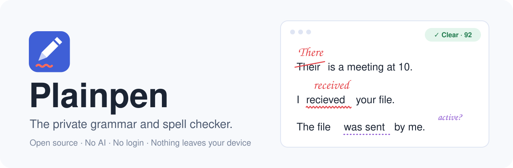
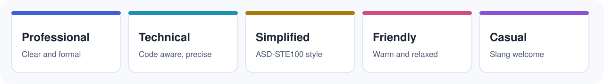
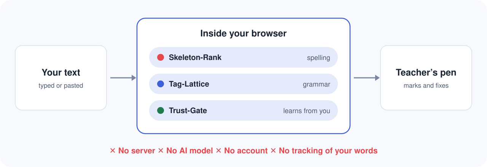

<div align="center">

<a href="https://konkomaji.com/plainpen">
  <picture>
    <source media="(prefers-color-scheme: dark)" srcset=".github/assets/banner-dark.svg">
    
  </picture>
</a>

### Your writing never leaves your device.

Open source. No AI. No login. No ads. Your words are never used to train anything.

<a href="https://konkomaji.com/plainpen"></a>


<a href="https://github.com/konkomaji/plainpen/stargazers"></a>


[How it works](#how-it-works) &nbsp;·&nbsp; [Features](#what-you-get) &nbsp;·&nbsp; [Run it yourself](#run-it-yourself) &nbsp;·&nbsp; [Contribute](#contributing) &nbsp;·&nbsp; [Support](#support-plainpen)

<a href="https://buymeacoffee.com/konko" target="_blank" rel="noopener noreferrer"></a>

</div>

---

## Why Plainpen

Most writing tools send every word you type to a server. Many use it to train AI models.
Plainpen does the opposite. The whole checker runs inside your browser tab.

| | Plainpen | Typical cloud checker |
|---|---|---|
| Where your text goes | Stays on your device | Sent to a server |
| Used to train AI | Never | Often, or unclear |
| Account needed | No | Usually |
| Ads or upsells | None | Common |
| Works offline | Yes | No |
| Source code | Open (MIT) | Closed |

## What you get

- **Spelling, grammar, punctuation and style** checks in one pass.
- **Five writing modes:**

  <picture>
    <source media="(prefers-color-scheme: dark)" srcset=".github/assets/modes-dark.svg">
    
  </picture>

  Professional, Technical, Simplified, Friendly and Casual. Each mode has its own rules and tone.
- **Simplified Technical English** checks based on the ideas of ASD-STE100: short sentences, active voice, one instruction per step.
- **American, British and Indian English**, plus the Banglish dialect (Pujo, Pandel).
- **Modern language:** text speak, stretched words ("sooo"), Gen Z slang, romanised Hindi and Bengali, and brand names.
- **Teacher's pen:** mistakes are marked like a teacher marked the page, with handwritten corrections you can click.
- **It learns from you, on your device.** Accept or dismiss a suggestion and Plainpen adjusts. Rules you keep dismissing go quiet.
- **Your own word Brain:** teach a word as a name, place, brand, acronym, term or slang, with a note and exact casing. Export and import your word lists.
- **Long documents:** up to 12 million characters. Only changed paragraphs are checked again.
- **Case converter:** UPPER, lower, Sentence, Title, camelCase, snake_case and more.
- **Install it as an app** on desktop or phone. Share text to it from other apps.
- **Encrypted local storage** (AES-GCM 256) and passphrase protected backups.

## How it works

Plainpen uses rules, a dictionary and three original algorithms. There is no AI model inside it.

<picture>
  <source media="(prefers-color-scheme: dark)" srcset=".github/assets/how-it-works-dark.svg">
  
</picture>

1. **Skeleton-Rank (spelling).** Plainpen finds candidates by edit distance and by a consonant skeleton, so "fone" finds "phone". It ranks them by a keyboard aware distance, how common the word is, and your own past corrections.
2. **Tag-Lattice (grammar).** Plainpen tags every word by its role and its ending. A rule can then say "a form of *be* followed by a past participle", not only match fixed words.
3. **Trust-Gate (learning).** Each rule has a trust score for each writing mode. Your accepts and dismissals update it:
   `trust = (accepted + prior × 4) / (accepted + dismissed + 4)`.
   Rules below 35 percent go quiet. It is counting, not a model.

## Benchmarks

| Test | Result |
|---|---|
| Spelling, correct word ranked first | 83.5% (simple baseline: 57.6%) |
| Spelling, correct word in top 5 | 95.3% |
| Grammar test set, precision and recall | 100% and 100% |
| False alarms on clean text | 0 |
| Speed | About 140,000 to 240,000 words per second |
| Robustness checks (fuzzed text, huge inputs, import attacks) | 4,851 of 4,851 pass |
| Security and content checks | 377 of 377 pass |

The grammar and spelling test sets are small and written by the author. They guard against regressions. They are not a public benchmark yet.

## Run it yourself

Plainpen has no dependencies and no build step. Node 20 or newer is only needed for the dev server and the tests.

```bash
git clone https://github.com/konkomaji/plainpen.git
cd plainpen
npm start     # http://localhost:8080 with the same security headers as production
npm test      # accuracy, robustness, security and content checks
```

To host your own copy, upload the site files to any static host.

1. Set your address: `node tools/configure.mjs --url https://your.domain/path`
2. Upload the files.
3. Keep the security headers. `_headers` works on Netlify and Cloudflare Pages. `.htaccess` works on Apache and LiteSpeed.

## Project structure

| Part | File | What it does |
|---|---|---|
| Engine | `js/engine.js` | Dictionary, spelling, grammar, modes and regions. Pure JavaScript, no DOM. |
| Knowledge | `js/lexicon.js` | Rules and word data as plain tables: regional spelling, dialects, STE word lists. |
| Learning | `js/profile.js` | Trust-Gate, the word Brain, safe import and export. |
| Storage | `js/store.js` | Encrypted local storage and passphrase backups. |
| Worker | `js/worker.js` | Runs checks off the main thread, in slices, with cancel and restart. |
| Case tools | `js/textcase.js` | Case conversion that respects your word Brain. |
| Interface | `js/app.js`, `style.css`, `design/` | DOM only, no `innerHTML`, so Trusted Types can be enforced. |

## Privacy and security

- Your text is never uploaded. The site makes no network requests with your writing.
- A strict Content Security Policy blocks outside scripts. Trusted Types blocks unsafe code paths.
- Everything Plainpen saves stays in your browser, encrypted.
- See [SECURITY.md](SECURITY.md) to report a problem.

## Known limits

- **Grammar is rule based.** It catches common errors with high precision. It does not parse every sentence, so it can miss subtle errors.
- **The dictionary is an open word list** of about 275,000 words. You can add newer words in `data/extra.txt` without changing code.
- **STE mode checks the rules that a pattern can check.** The official ASD-STE100 dictionary is licensed by ASD and is not included.
- **The built-in list of places is small:** countries, major cities and Indian states. Larger packs can load from `data/packs/`.

## Contributing

Rules, word lists and test cases are all welcome.

1. Add or change rules as rows in `js/lexicon.js`.
2. Add a test case for each rule.
3. Run `npm test` before every pull request. The checks cover accuracy, robustness, security headers, unsafe code patterns, external links, design tokens and page copy.

## Support Plainpen

Plainpen is free, with no ads and no paid plan. If it helps you, you can buy me a coffee.

<a href="https://buymeacoffee.com/konko" target="_blank" rel="noopener noreferrer"></a>

A star on GitHub also helps other people find it.

## License

[MIT](LICENSE). Created by [Konko Maji](https://konkomaji.com).

Word list: `an-array-of-english-words` (MIT). Fonts: Poppins and Caveat (SIL Open Font License). ASD-STE100 is a standard owned by ASD.
